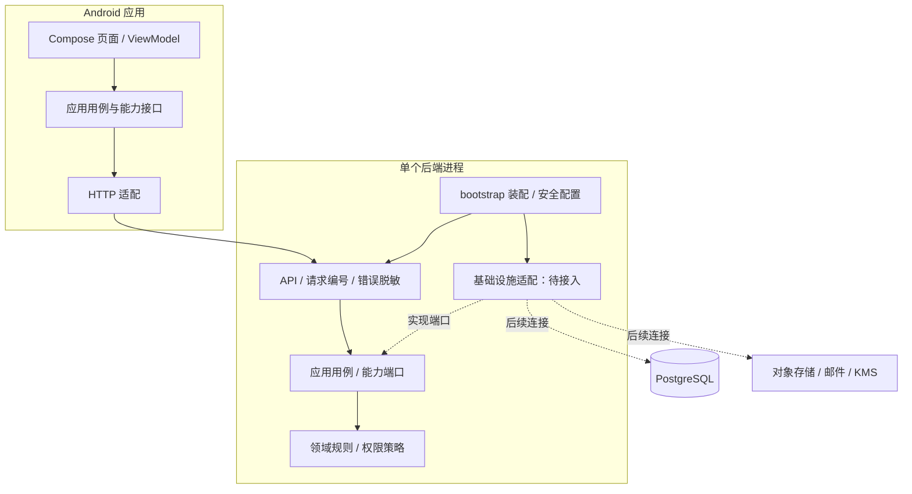

# 第一阶段实施方案

2026年11月6日。目标是建立可构建、可启动、有边界约束的开发基础，不在本阶段提前实现账号、空间 CRUD 或模拟持久化。

## 执行范围

1. 后端使用一个 Maven reactor，划分 domain、application、api、infrastructure、bootstrap 五个编译模块。前四个对应业务规则、用例、接口适配和基础设施，bootstrap 只做装配与启动；最终仍为一个可执行服务，不是五个微服务。
2. 领域模块保存已确认的基础访问规则，应用模块定义读取权限上下文的端口与协调能力；API 与基础设施通过核心接口接入。未接通数据库的业务端口不提供假成功实现。
3. API 建立统一请求编号、Problem Details、参数错误和异常脱敏。安全入口复用相同错误输出，未知业务入口继续默认拒绝。
4. Android 保留单一 Gradle app 模块，在内部区分应用入口、UI 状态持有者、诊断用例和网络适配。诊断连接只用于开发，不实现或暗示业务已可使用。
5. Docker 成为可选基础设施项。bootstrap 下的构建、测试与启动不要求 Docker，也不使用 H2 或内存数据冒充 PostgreSQL 权限和事务验证。
6. 脚本、镜像上下文、CI、文档和运行路径随模块调整同步更新；数据库迁移仍显式独立执行，不进入普通应用进程。

## 后端依赖



上图实线表示分层组织及允许的调用方向；业务 HTTP 路由尚未接入。虚线表示预定端口实现关系与后续基础设施接入，并不代表存储、投递或内容加密已完成。

```text
domain          仅 JDK
application     → domain
api             → application 与 Web 适配能力
infrastructure  → application 与存储、加密等技术依赖
bootstrap       → api、infrastructure；负责 Spring 装配和安全配置
```

领域与应用层不得依赖 Spring、HTTP、JDBC 或云 SDK。API 不得依赖基础设施。普通业务层不得引用 bootstrap。使用架构检查防止越层依赖与循环。

基础权限策略仅表达普通读写：空间外不可见，AUTHOR_ONLY 限原作者，BOTH 可共同编辑删除，只有原作者可切换模式，冻结后普通操作只读。账号注销清除的受控例外不伪装成普通写权限；完整事务、锁、RLS 和清除流程留在后续阶段验证。

## Android 边界

```text
MainActivity / AppContainer   组成根，装配依赖
ui                           页面与状态持有者，调用诊断用例
application                  诊断用例和能力接口
data                         HTTP 具体实现
core                         端点与网络安全配置
```

UI 不直接创建 HTTP 连接或读取持久化；网络实现不依赖 Compose。客户端领域层不为一个诊断功能强行复制服务端业务模型。正式功能出现后再按模块继续组织。

开发诊断用于读取现有 Actuator 最小健康状态，不增加公共用户查询、业务后门或新的产品功能。调试包允许受限本机 HTTP 地址，发布配置要求 HTTPS，诊断界面不在发布包用户流程中出现。

## 验收条件

- 不运行 Docker 仍可完成 Maven verify、Android 单元测试、assembleDebug、lintDebug。
- 后端启动产物来自新的 bootstrap 模块，不能误用旧 target 中的历史 JAR。
- 架构规则和已确认权限策略有实际验证；共同编辑不能授予另一方切换权限，冻结不能被普通操作绕过。
- 请求编号由服务端生成，错误响应、响应头和日志上下文一致，不信任外部任意编号。
- 安全、字段校验和未知异常使用统一格式，不把请求原值、密码、堆栈或内部异常消息返回客户端。
- Android 网络访问离开主线程，UI 有明确的未检查、检查中、可达及不可达状态；失败不展示原始网络异常或假成功。
- 数据库不可用时不宣称持久化功能已通过；bootstrap 就绪仅代表应用基础进程，而非数据库业务就绪。
- 私密配置及缓存仍被 Git 忽略；CI 配置更新但未执行前不声称远程 CI 已通过。

## 当前不包含

业务数据库迁移及 RLS 验收、真实注册与邮件、对象存储和 KMS、正式产品页面、语音、多人空间、线上部署和 Git 提交推送。现有设计稿继续作为后续产品 UI 的输入。

以上为第一轮架构搭建时的范围。第二轮按“完成剩余基础内容”的指令继续补齐，实际验收以环境记录和阶段验收表为准。

## 第二轮补齐范围

- 使用校验过的 PostgreSQL 17.11 Windows 便携包，不安装系统服务，不依赖 Docker。私密数据位于 `.dev/postgres`，只监听 `127.0.0.1:55432`；中文路径以数据库运行期间保留的盘符别名处理。
- 保持已应用 V1 不变，新增 V2 建立主体、空间、成员、梗密文基础表、索引、外键、双人容量约束及只读 RLS。媒体和运维保留独立 schema，未提前创建未评审的完整业务表。
- 增加 ActorTransactions 端口、Spring JDBC 事务实现、JDBC 权限元数据读取与 local profile 装配。业务用例从已验证会话取得身份，在同一事务执行；目前普通应用角色无产品写权限。
- 建立 identity、space、entry、media、lifecycle 业务边界，详见 [模块说明](modules.md)。未完成的能力只有明确端口或包边界，无假实现和占位成功路由。
- 增加真实数据库集成验证、迁移重复执行与校验、Android 锁文件、Maven SBOM、OpenAPI 校验、格式检查、秘密扫描、漏洞审计及 Actions 专用语法校验。
- 以 `Verify-Foundation.ps1 -Full` 完成本地完整验证；CI 同步执行真实 PostgreSQL 验证并增加容器构建。远程运行、公开上传范围和仓库保护设置在实际验证前保持待验收。

原计划的产品阶段 2 及之后不提前纳入本轮：真实账号、正文加密、邀请、可变记录、对象存储和清除闭环仍需逐阶段交付。Docker 本机运行按用户安排继续暂缓。
