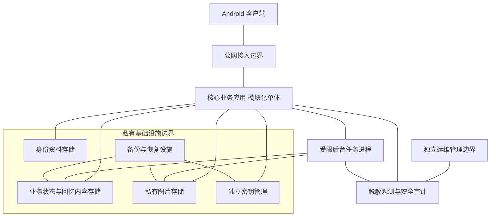

# 双人梗簿主体架构设计

版本 v0.2｜2026年11月6日｜架构评审稿

本稿依据已确认的产品需求，先确定系统组成、业务职责、部署单元、隔离与信任边界。数据库表、字段、接口契约、事务 SQL、事件载荷及详细数据流暂不展开。v0.1 中这些实现细节保留为参考建议，不视为已定方案。本稿的技术建议也不等于用户新增了产品需求。

## 1 首先澄清内容主库

内容主库是保存业务权威状态的存储角色，不代表一种 JSON 格式，也不代表所有内容放在同一张表。主库的“主”表示当前有效状态以此为准，强调读写一致性，而不是数据分类方式。

业务需要区分账号身份、空间及成员关系、回忆记录、图片资源、运行状态与审计信息。关系型数据库适合保存结构化业务状态和约束；图片文件适合放私有对象存储。正文可以按隐私方案以密文存储，但其密文格式不决定整个数据库采用 JSON 文档模型。

“现在保存了什么”和“过去改过什么”是两种不同能力。产品已确认能保存、编辑和删除记录，尚未确认完整历史版本功能；因此不把内容主库设计成必须重放全部操作日志才能得到当前记录的事件仓库。安全审计关注谁执行何类操作及是否获准，不默认保存被修改前后的正文和图片。

本阶段决定数据职责分类，不决定每类建多少表、几个 database 或几个实例；物理隔离强度留到存储和部署细化阶段评审，不能由“分类”直接推导为每类一个微服务。

## 2 架构目标与约束

已确认的产品约束：Android 独立 App；多个相互隔离的双人空间；文字与图片；默认原作者可编辑和删除，可由原作者开启双方编辑与删除；任一方退出后空间整体冻结，双方保留只读历史；平台人员不得随意访问；端到端加密待评估。

主体架构需要满足：

- 权限控制覆盖所有内容入口，包括图片和后台处理，不只覆盖页面按钮。
- 共同编辑、权限切换和冻结遵循同一权威业务规则，不在不同模块分别解释。
- 身份资料、回忆内容、密钥和运维权限分开管理，避免单个后台入口获得所有敏感能力。
- 系统可以按实际负载扩展，同时不要求首版承担不必要的分布式一致性和运维成本。
- 正常使用、弱网重试、故障恢复和运维操作不破坏双方应看到的历史。

没有已知流量、预算、团队规模、时延或可用性目标，不预设高并发规模、服务器数量、成本或工期。

## 3 整体组成

此图表示组件和访问关系，不表示数据库 schema 或具体请求顺序。每条连接都需要明确权限，不意味着相连组件具有对方的全部管理权限。备份与恢复设施不要求保存明文密钥；密钥恢复能力依赖最终密钥方案。

### 3.1 Android 客户端

负责展示空间与回忆、文字输入、用户选图、编辑模式呈现、冻结只读状态及本地会话保护。服务端仍须验证客户端操作是否合法，不能因为 App 隐藏了按钮就放行。

本地私密内容也属于安全范围：账号隔离、私有存储、受控缓存、凭据保护及系统备份策略均需设计。截图限制、离线回看、导出等尚未确认为产品功能。

### 3.2 公网接入边界

只暴露必要的业务入口，负责安全传输、基础限流、请求大小限制与入口防护。数据库、密钥管理、后台控制面和图片管理端不直接开放公网。

入口层做基础认证及防护，空间成员和内容编辑权限仍由业务核心判断。不能把用户知道空间 ID 或图片地址当作授权。

### 3.3 核心业务应用

首版作为一个可部署应用，内部明确模块边界：

| 模块 | 职责 | 不应承担的职责 |
| --- | --- | --- |
| 身份与会话 | 确认当前操作者、会话及账号状态 | 维护回忆正文或决定记录编辑权限 |
| 空间与关系 | 空间生命周期、邀请、两位成员、历史访问资格 | 独立复制一套记录内容 |
| 共同回忆 | 文字与图片关联、原作者、共同编辑、删除与冻结约束 | 信任客户端提交的权限判断 |
| 媒体管理 | 用户选图后的受控接收、资源处理与私密读取 | 绕过空间规则修改已冻结内容 |
| 授权策略 | 统一解释谁可看、谁可改、什么状态可操作 | 替代身份认证或提供面向平台的内容查看入口 |

查询与写入是这些业务模块的两类职责，不必分别成为微服务。查询关注按权限展示当前状态，写入关注合法性、一致性与冲突处理。它们应采用同一套授权语义，但可以使用不同的内部处理器及存储访问权限。

空间、共同回忆和冻结属于同一个必须强一致的业务核心。即使代码拆成多个模块，也保留统一协调能力；不把退出解释为异步通知各模块“有空时停止写入”。

### 3.4 后台任务进程

用于耗时或可重试的图片处理、未提交资源清理等工作，避免拖慢交互请求。可与核心应用共享代码仓库，但独立进程、独立运行身份、受限权限和受控任务类型。

独立进程可控制资源和故障影响，不自动构成独立微服务。后台进程也不能因为“不直接面对用户”就拥有所有空间正文、密钥和任意内容修改权限。

冻结后的图片不能被后台任务替换成其他内容。若选择端到端加密，不能读取明文的后台进程也不能承担明文图片压缩和缩略图生成，相关能力需转到客户端。

### 3.5 存储与密钥设施

身份资料、业务状态与回忆内容、图片资源分别明确责任和访问范围。首版正文等权威查询与写入使用同一主存储，避免旧副本参与权限与冻结判断；是否需要只读副本由后续测量决定。

密钥管理独立于普通数据存储和后台管理权限。数据库、图片存储与备份的加密不能只靠把密钥放在同一处配置文件中。存储类别与密钥类别的物理部署方案在下一阶段确定。

### 3.6 运维与安全管理

运维管理入口与用户业务入口分开，不提供任意浏览用户回忆的界面。配置、发布、数据库、图片、密钥和备份权限分级，敏感权限使用临时授权与独立审计。

日志与统计仅包含排障及安全所需最少信息；不录入回忆正文、图片、有效邀请、密码、会话凭据或密钥。能发布服务端代码的人也可能取得应用能读取的内容，部署权限同样属于隐私边界。

## 4 云端隐私的信任边界

### 4.1 上传云端与上传明文不同

在线共同空间需要向服务端同步必要信息，但不代表必须上传整个通讯录、完整相册或所有账号资料。需要把三类信息分开：

- 身份信息：登录所必需的资料，具体种类取决于未定的登录方式。
- 内容：用户主动提交的文字和图片，可按方案上传密文。
- 元数据：成员关系、时间、大小、空间状态及访问记录等；即使正文端到端加密，这些信息通常仍需被系统处理。

云服务商负责一部分基础设施安全，应用方仍需负责自身的数据、访问控制、配置与应用安全；购买云服务器不等于自动保证隐私。[S1]

### 4.2 两种隐私模式

| 方面 | 模式 A 服务端可解密 | 模式 B 端到端加密 |
| --- | --- | --- |
| 正文与图片 | 受控应用进程可解密处理 | 授权用户设备解密，服务端只处理密文 |
| 运营和客服 | 默认无查看入口、无解密权限 | 正常架构中不具备内容解密能力 |
| 应用服务器被攻陷 | 攻击者可能借用应用解密权限 | 在密钥和客户端安全前提下，降低服务器直接读取历史内容的风险 |
| 图片处理 | 可在受限服务端处理 | 明文处理主要移至客户端 |
| 换机和找回 | 由平台受控恢复相对直接 | 需要额外的用户密钥恢复与设备管理方案 |
| 剩余风险 | 应用权限滥用、终端泄露、元数据等 | 终端失陷、恶意客户端、另一方外传、元数据等 |

模式 A 可以采用每空间独立密钥与独立 KMS，降低数据库、图片存储或备份单独泄露的风险。信封加密把数据加密密钥与其包装密钥分开管理，但不等于应用无法读取。[S2]

模式 B 不能只把密钥搬到另一台云服务器；如果平台仍能取回解密密钥，就不能据此声称平台无法读取。端到端加密需要可信客户端、成员设备间的密钥分发与验证，以及恢复和撤销方案。不能以一个加密开关代替设计。

现有已确认需求是限制平台人员随意访问，尚未要求平台完全无解密能力。因此模式 A 是可评审的 MVP 选项，模式 B 保留为隐私强度决策；本稿不擅自认定用户已接受任何一种。主体结构能先讨论，但两种模式会改变客户端、媒体和密钥职责，实施前必须确定。

### 4.3 必须覆盖的泄露面

| 风险面 | 主体架构中的控制 | 无法因此消除的风险 |
| --- | --- | --- |
| 网络窃听 | 安全传输及正确证书校验 | 终端或服务端被控制 |
| 陌生账号与其他空间 | 统一授权、空间隔离、私有图片访问 | 授权实现缺陷，需测试验证 |
| 存储及备份泄露 | 加密与独立密钥管理、私网和最小权限 | 同时取得应用和密钥使用权限 |
| 内部人员 | 后台无正文入口、分权、审批、审计及发布控制 | 高权限串通、策略配置错误 |
| 日志与第三方 SDK | 最小化采集、脱敏、限制外发 | 未受审查的 SDK 或调试配置 |
| 用户设备与朋友外传 | 本地保护及清晰的分享边界 | 对方截图、拍照或主动转发 |

不能保证绝不泄露。应按威胁模型、访问控制验证、发布审查与恢复演练提供可检查的保护证据，而不是以“用了加密”作绝对承诺。

## 5 为什么首版不拆微服务

业务模块、部署进程、服务器和微服务不是同一个概念。一个业务应用可拥有清晰模块边界、运行多个实例，也可搭配独立后台任务与独立存储，不需要把每个模块都做成单独服务。

当前空间、记录权限和退出冻结紧密关联；过早拆开，会增加跨服务授权、状态同步、网络故障处理和运维工作。微服务还需要服务间身份、密钥与可观测性治理，不会天然让隐私更好。微软架构指南也指出其组件数量与运维复杂度高于等效单体。[S3]

建议 MVP 的部署单元是：Android 客户端、核心业务应用、受限后台任务，以及分别受控的存储、密钥和运维设施。核心应用内部保持模块化；是否对身份或图片组件进一步物理隔离，按实际威胁模型和运维能力评审。

以下情况出现后再考虑提取微服务：

- 某能力确有独立负载瓶颈，需要单独扩缩容。
- 独立团队需要独立发布并维护稳定职责边界。
- 某类处理需要更强的运行权限和故障隔离。
- 测量证明单体现有结构造成问题，且拆分收益大于新增运维与一致性成本。

优先考虑边界清晰的图片处理等能力；空间、记录权限和冻结不因追求服务数量而拆散。是否拆分不是产品安全合格与否的判断标准。

## 6 主体架构评审结论

建议评审接受以下方向后，再进入下一阶段：

1. Android 加模块化业务核心，后台任务按进程隔离。
2. 查询与写入职责分开，空间、记录权限及冻结保留统一强一致边界。
3. 身份、回忆、图片和密钥按职责与敏感程度隔离；物理部署强度后续确定。
4. 平台管理、日志、备份和用户设备均纳入隐私边界，不只关注数据库。
5. 首版不按模块机械拆微服务；服务端可解密或端到端加密在实现前单独决策。

主体架构层尚待决定：云端对内容的信任程度、上线地区、部署预算、运维与开发能力、可靠性目标。这些属于影响架构取舍的真实未知项，不填虚构答案。

上述方向确定后，才依次细化业务对象与存储分类、数据库结构、接口契约和关键流程的数据及事务时序。

## 7 参考资料

访问日期均为 2026年11月6日。组件能力资料不代表本产品已经通过安全审计。

- [S1 AWS Shared Responsibility Model](https://aws.amazon.com/compliance/shared-responsibility-model/)
- [S2 Google Cloud Envelope Encryption](https://docs.cloud.google.com/kms/docs/envelope-encryption)
- [S3 Microsoft Microservices Architecture Style](https://learn.microsoft.com/en-us/azure/architecture/microservices/)
