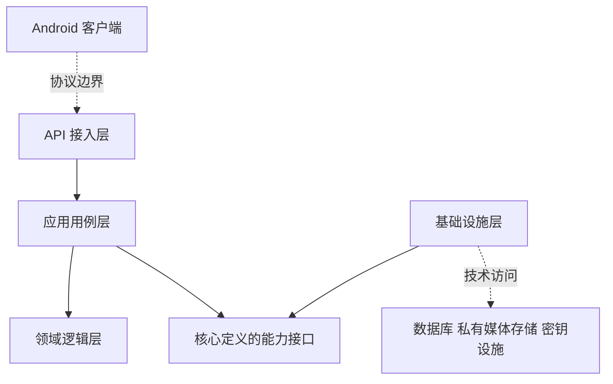

# 双人梗簿分层主体架构

版本 v0.3｜2026年11月6日｜设计评审稿

本稿将主体架构收敛为客户端、服务端四层与数据资源，明确层间职责和依赖规则，回应简洁性、可扩展性、可靠性、可维护性与隐私要求。主体分层以本稿为准；v0.1 和 v0.2 中数据库结构、事务写法与部署细节均保留为参考建议，未形成实施定案。

MVP 已确认功能保持不变：Android、双人私密空间、文字图片、作者及双方编辑模式、退出整体冻结并双方只读保留。语音为用户提出的未来扩展示例，不加入当前已确认 MVP。本文不展开数据库表、字段、接口契约及详细数据流，也不预设技术语言、云厂商或性能数值。

## 1 整体分层

推荐采用模块化单体，在同一业务应用内部实施分层。客户端与服务端用例层的名称需区分：Android 是用户操作的客户端；服务端应用层是组织业务动作的用例层，不是手机页面。

| 部分 | 职责 | 不承担的职责 |
| --- | --- | --- |
| Android 客户端 | 展示、输入、用户选图、本地状态与设备隐私保护；未来可加录音及播放 | 决定最终成员资格和写入权限 |
| API 接入层 | 协议适配、请求格式校验、认证上下文、调用用例、返回标准结果 | 编写空间冻结规则、直接操作数据库或云存储 |
| 应用用例层 | 组织发布、编辑、删除、权限切换、退出等业务动作；控制事务与幂等边界 | 将数据库、云 SDK 和媒体编解码细节写进用例 |
| 领域逻辑层 | 统一定义成员访问、原作者、共同编辑、空间状态及冻结约束 | 依赖 HTTP、数据库连接、云 SDK 或手机界面 |
| 基础设施层 | 实现数据访问、文件存储、密钥管理、媒体处理及任务执行等技术能力 | 自行决定谁可以修改记录，或绕过用例提交业务变化 |
| 数据资源 | 业务数据、私有媒体对象、密钥、受保护备份与审计存储 | 作为用户直接调用的业务入口 |

服务端真正的四层是 API、应用用例、领域逻辑、基础设施。数据资源是被访问的基础资源，不再叠加一层重复的业务逻辑。数据库自身的约束和权限是额外防线，不取代领域规则与用例协调。

## 2 代码依赖方向

实线表示主要代码依赖，虚线用于标明客户端协议边界及基础设施访问资源的关系，不代表请求流程。能力接口由应用用例层或领域核心按需要定义，基础设施负责实现；领域核心不反向导入具体技术实现。这种依赖方向用于隔离业务与技术变化。[S1]

程序启动时在单独的装配位置选择并连接实现。启动装配可以知道各层，API 处理器和业务模块不能因此直接调用具体数据库或对象存储实现。运行时业务通过接口使用基础设施，不表示编译时依赖方向反转。

约束如下：

1. 禁止 API 绕过应用用例直接读写存储。
2. 禁止领域逻辑引用 API、数据库、云 SDK 或 Android 代码。
3. 禁止出现应用层与基础设施层互相导入的循环依赖。
4. 禁止后台任务另写一套权限、共同编辑和冻结规则；发生业务状态变化时必须进入相同用例边界。
5. 禁止将 HTTP 请求对象、ORM 实体、数据库连接或云 SDK 对象传入领域逻辑。
6. 仅为明确可变的技术能力定义接口，不给每个普通函数增加一层无意义封装。

## 3 分层与业务模块的关系

分层管理技术职责，模块划分业务职责，两者配合使用。不是分别做一个巨大的 controller 文件夹和一个巨大的 service 文件夹，就自动获得模块解耦。

保留四个主要业务模块：

| 模块 | 负责的业务 |
| --- | --- |
| 身份与会话 | 当前操作者、登录状态、账号及设备会话 |
| 空间与关系 | 双人成员、邀请、空间生命周期与历史访问资格 |
| 共同回忆 | 记录、原作者、共同编辑、删除及冻结规则 |
| 媒体 | 图片及未来语音等附件的共同行为与类型差异 |

这些模块共享明确的核心规则，通过受控模块接口协作，不互相操作对方存储。空间和共同回忆的强一致动作由应用用例协调，不因模块划分变为多个异步、独立提交的动作。

授权属于核心规则的一部分，不建设一个必须远程调用、拥有独立规则副本的权限微服务。网络认证由入口验证，空间和记录授权由核心统一解释；各层不能用同名但含义不同的“权限判断”相互替代。

## 4 读写职责

应用用例层区分查询与变更：查询用于按权限展示，变更用于合法地修改状态。首版共用同一权威存储，不为读写分别维护两份内容。

查询可以使用专用读取实现，不需要为列表展示加载全部业务对象，但必须执行核心定义的可见性规则；不能以“只是读取”为理由绕过成员与资源授权。

变更必须统一协调权限、当前状态、并发和持久化成功条件。共同编辑的修改不能静默覆盖，空间冻结之后不能有正文、权限或附件写入成功。这里确定一致性目标，具体数据库锁、版本和接口行为在下一阶段设计。

后续增加其他入口或后台调用时，复用现有用例和领域规则。新增入口不能复制一份规则，否则两个入口可能对同一操作给出不同结论。

## 5 以语音验证可扩展性

当前图片与未来语音都可作为记录的媒体附件，但不能因此假定所有媒体的处理方式完全相同。应区分共同行为与类型能力。

共同行为包括空间归属、作者和编辑授权、私密访问、保存与删除、附件可用状态、冻结保护和资源清理。类型能力包括图片解码及缩略图，以及未来语音的编码校验、时长约束与播放支持。

新增语音的预期改动范围：

- Android 增加录音或选择音频、播放及必要设备权限体验。
- API 接入层增加相应输入适配和格式校验；是否新增接口由后续契约设计决定。
- 应用层复用媒体附件用例；只有业务行为确实不同才新增用例。
- 媒体模块加入音频类型与处理策略，基础设施实现音频所需的技术处理。
- 原有空间成员、共同编辑、冻结和私密访问规则继续复用，并扩展相应验证场景。

这表示变更被控制在明确位置，不表示增加语音可以完全不改代码、存储或接口。新类型引入后仍要验证容量、处理成本及隐私影响。

首版只预留实际需要的媒体能力接口与类型分派，不建设通用插件市场、动态脚本引擎或支持所有未来类型的复杂平台。若采用端到端加密，明文媒体处理放在客户端；若采用服务端受控解密，则按权限置于受限技术组件，不能混淆两种信任模型。

## 6 隐私与安全贯穿各层

| 边界 | 责任 |
| --- | --- |
| 客户端 | 本地私密数据、会话、账号切换、系统备份和设备权限保护 |
| API | 安全传输、身份验证、输入约束及必要限流，不信任客户端给出的身份和权限结论 |
| 应用用例 | 为每次操作建立可信上下文，协调最终授权与状态变化，避免旧权限被重用 |
| 领域逻辑 | 对成员资格、作者编辑、共同编辑和冻结提供一致规则 |
| 基础设施与存储 | 最小权限、私网访问、私有媒体、密钥隔离、加密及受控备份 |
| 运维与观测 | 管理访问分权、发布控制、脱敏日志与独立审计，避免额外制造内容副本 |

分层隔离用于减少误用和变化影响，不构成密码学隔离。拥有服务端明文处理和密钥使用能力的进程失陷时，仍可能暴露内容。端到端加密是否采用仍待评审；当前架构不能据此宣称平台无法读取。

安全故障应默认拒绝敏感操作：无法确认身份、权限或空间状态时，不以旧的允许结果继续读写。冻结后的原两位成员仍保留合法读取资格，不能把退出错误解释为不再能查看历史。

## 7 可靠性

可靠性需要明确成功条件、失败行为和恢复证据，不能由分层或微服务数量保证。

| 目标 | 主体架构中的措施 | 验证关注点 |
| --- | --- | --- |
| 关键状态一致 | 空间、编辑权限、记录和冻结由统一用例协调 | 保存、删除、权限关闭与退出并发时结果符合产品规则 |
| 重试安全 | 为关键变更建立幂等语义，区分可重试和不可重试错误 | 弱网、响应丢失或重复提交不产生重复记录和状态反复 |
| 故障隔离 | 耗时媒体处理使用受限后台进程，资源与任务数量有边界 | 媒体处理失败不拖垮身份或普通查询 |
| 数据可恢复 | 内容、媒体和解密能力一并纳入备份恢复方案 | 恢复后能实际读取记录和媒体，而非只有数据库恢复成功 |
| 服务可诊断 | 脱敏指标、请求关联与关键故障告警 | 可以定位故障，不需要日志记录私密内容 |
| 发布可控 | 存活与就绪检查、平滑停止、兼容性与回滚方案 | 发布期间不接受无法完成的新任务，不损坏关键状态 |

业务只能在达到约定的持久化条件后报告成功；图片或未来语音未准备好时，不伪装成完整保存成功。关键冻结不依赖后台稍后处理才生效。退避重试必须有次数或时间边界，避免无限重试扩大故障。

可用性目标、恢复点、恢复时长及性能目标仍待确定，不能填未经讨论的数值。架构也不默认承诺单实例高可用；是否部署多实例和冗余基础设施，应在预算及可靠性目标确定后决定。

## 8 可维护性与简洁性

保持一个清晰代码仓库和少量部署单元；模块具有明确责任和所有权，领域规则集中、技术实现可替换。首版不引入没有实际需要的微服务治理、读模型同步、分布式事务或复杂插件设施。

验证重点应随职责分层：领域规则验证共同编辑与冻结，用例验证授权及失败协调，基础设施验证真实存储和密钥集成，少量端到端场景验证完整用户操作；通过架构依赖检查防止循环和越层调用。这里规定后续验证策略，不声称已完成这些测试。

使用统一错误语义、配置管理和依赖版本管理。仅保留必要公共类型，避免把所有规则塞进通用工具包，或让一个公共包成为所有模块互相引用的入口。

## 9 部署边界

推荐的首版部署边界仍为 Android 客户端、核心业务应用、受限后台任务进程、受保护存储及密钥设施。四层是代码职责，不是要求四台服务器或四个微服务。

核心应用可以在未来运行多个实例，不需要先拆业务服务。只有独立扩容、团队发布或权限隔离需求明确后，才评估将边界清晰的能力提取成服务；提取时仍保留业务授权与冻结的一致性要求。

## 10 主体架构验收标准

1. 任一新增业务入口均经应用用例调用核心规则，不能直接操作数据资源。
2. 新增语音的主要变化位于客户端、媒体接入与媒体处理，不复制空间或冻结规则。
3. 修改数据库或对象存储实现，不要求重写领域逻辑；技术迁移成本仍需具体评估。
4. API、应用用例、领域逻辑和基础设施之间不存在循环依赖。
5. 读、写、媒体及后台操作遵循一致的空间可见性与冻结要求。
6. 故障、重试、发布和恢复的行为可验证，且日志不泄露用户私密内容。
7. 不为了扩展预期引入尚无使用场景的大量抽象与部署单元。

主体架构下一步待评审事项：是否接受上述分层及边界；端到端加密或服务端受控解密的选择；上线地区、规模、预算与可靠性目标。此后再进入数据库、接口契约和数据流设计。

## 参考资料

[S1 Microsoft Common Web Application Architectures](https://learn.microsoft.com/en-us/dotnet/standard/modern-web-apps-azure-architecture/common-web-application-architectures)

访问日期：2026年11月6日。参考其中业务核心与基础设施的依赖倒置原则，不据此指定本产品必须使用 .NET，也不视为产品已获得可靠性或安全认证。
