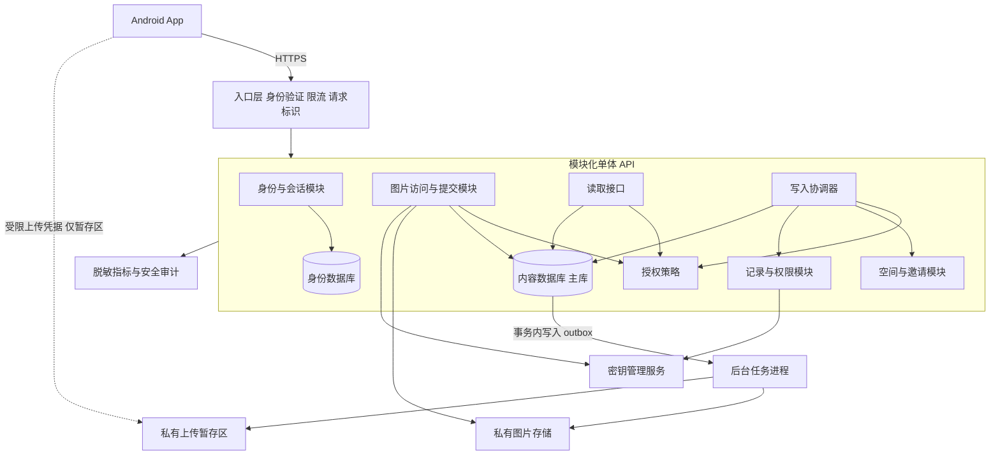

# 双人梗簿系统架构设计

版本：v0.1｜日期：2026年11月6日｜状态：架构建议，待技术评审

依据：同目录《双人梗簿_PRD_v0.1.docx》及其 Markdown 源稿。本文不变更已确认产品规则。技术组件、隔离方式和安全控制属于建议；流量、预算、SLA、RPO、RTO、上线地区及端到端加密尚未确定，本文不编造指标或承诺。

## 1 架构决策

推荐 Android 客户端、模块化单体 API、独立后台任务进程、PostgreSQL、私有对象存储、独立密钥管理服务。身份数据与内容数据分库，空间和记录保留在同一内容库；业务按模块划分 schema 和代码边界。首版不部署读副本、全文搜索、内容缓存、消息中间件或微服务集群。

读写分别设计应用层处理器及查询接口，但共用权威内容主库，不建立异步同步的第二套正文库。这是读写职责分离，不是物理读写分库。它支持以后按测量结果扩容，也优先保证权限变化、共同编辑和退出冻结的一致性。

数据库分库、schema、行级隔离、密钥隔离承担不同职责：分库限制账号资料与回忆内容的直接混查；schema 明确模块所有权；行级策略限制空间访问；加密降低数据库、对象存储和备份单独泄露的影响。它们均不自动防住拥有应用执行权限和解密权限的攻击者。

## 2 已确认的架构不变量

1. 每个使用中的空间只有两位成员；同一账号可以与不同朋友分别拥有空间。
2. 使用中空间的两位成员均能读取其记录；其他账号不可读取正文、图片或私密内容派生数据。
3. 原作者不可通过普通编辑接口改变。默认仅作者编辑和删除；共同编辑开启时双方可编辑和删除；仅原作者可切换模式。
4. 任一方退出，整个空间冻结，双方保留退出时的只读历史；所有内容写入与权限切换停止。
5. 平台人员不能随意访问正文和图片；是否要求平台在密码学上无法读取，仍待端到端加密评估。
6. 群体空间为未来方向；不为未来成员数量放松 MVP 的两人限制，不自动沿用双人退出规则。

## 3 系统视图

图中暂存区、正式图片区可以是不同 bucket。对象存储接口与密钥管理接口通过适配层封装，不绑定某家云。身份数据库和内容数据库可以先位于同一 PostgreSQL 实例的不同 database，但这只构成逻辑隔离，仍共享主机、管理员、故障域和部分运维风险；需要更强隔离时部署独立实例。

## 4 模块解耦与事务归属

| 模块 | 负责事项 | 边界约束 |
| --- | --- | --- |
| 身份与会话 | 登录身份映射、会话有效性、设备会话撤销 | 不保存回忆正文；对外输出不可枚举的用户标识及可信认证上下文 |
| 空间与邀请 | 成员关系、两人容量、邀请生命周期、空间状态 | 邀请不携带正文；不直接向图片存储授权 |
| 记录与权限 | 文字记录、原作者、编辑模式、版本控制 | 不自行维护第二份成员或冻结状态 |
| 图片 | 上传会话、内容处理、正式资源、受保护读取 | 对客户端不提供正式对象写权限；关联记录必须通过写入协调器 |
| 查询 | 空间列表、记录列表、详情 | 只读数据库角色；每次查询执行授权，不调用有副作用的写接口 |
| 写入协调器 | 新建、修改、删除、权限切换、退出冻结 | 统一开启内容事务、执行锁顺序及最终授权校验 |
| 后台任务 | 图片处理、未关联资源清理、事务事件消费 | 不得绕过冻结修改已提交内容；仅消费有明确类型的任务 |
| 安全审计与观测 | 操作结果、访问审计、错误率、延迟 | 不记录正文、图片、密钥、会话及有效邀请凭据 |

模块通过明确的接口调用，不互相导入对方数据库仓储或直接修改对方表。允许查询模块使用经评审的跨 schema 只读查询；不以每次内部调用都走 HTTP 的方式实现解耦。

空间、记录和图片关联的关键动作由一个应用事务协调。若未来拆分服务，应将这部分保留为一个强一致业务边界，不能把退出冻结仅作为异步广播，期待各服务最终各自停写。

## 5 数据库隔离

### 5.1 身份数据与内容分库

建议 `identity_db` 保存登录标识、认证所需资料及会话；`memory_db` 仅保存业务用户 ID、成员关系、空间、记录和附件元数据。身份映射查询通过身份模块完成，避免内容库放手机号、邮箱等不必要资料。

MVP 不需要跨库原子事务：发布记录只涉及内容库，先通过身份与会话校验；账号注销涉及共同历史的规则仍未确定，不能提前把注销设计成级联删除所有空间。账号创建至业务资料建立可采用可重试、幂等的建档过程。

建议区分身份运行角色、内容只读角色、内容命令角色、图片任务角色、迁移角色、审计写入角色；分别授权。若这些凭据都位于同一应用进程中，只能减少误用，不能把进程攻陷后的风险视为已隔离。后台任务与运维后台使用独立运行身份，密钥权限另行控制。

### 5.2 内容库的模块及空间隔离

建议 schema 划分为 `space`、`memory`、`media`、`infra`。所有空间内数据包含 `space_id`，包含记录、图片、上传会话、幂等请求及相关后台任务。使用联合唯一约束及联合外键，防止某空间的图片被关联到另一个空间的记录。

建议的主要对象：

| 对象 | 关键字段与约束 |
| --- | --- |
| spaces | id、status、version、frozen_at、frozen_by；冻结后正常业务不可转回活动 |
| space_members | space_id、user_id、slot、joined_at；空间与用户唯一；MVP slot 只允许 1 或 2 且空间与 slot 唯一 |
| entries | id、space_id、author_id、body_ciphertext、edit_mode、version；原作者固定；权限枚举受限 |
| assets | id、space_id、entry_id、object_key、object_version、state；已发布对象引用不可原地覆盖 |
| upload_sessions | id、space_id、requester_id、目标记录、预期版本、暂存引用、状态、到期时间 |
| idempotency_requests | user_id、space_id、operation、request_key、请求摘要、最小结果；限制有效期和作用域 |
| outbox_events | event_id、space_id、aggregate_version、event_type、必要对象引用；不带正文或图片 |
| space_keys | space_id、key_version、wrapped_key、key_metadata；不保存明文密钥 |

`slot` 方案是 MVP 的数据库硬约束建议；未来多人空间需迁移这一限制。这里的成员行代表历史访问资格，不能在退出时直接物理删除，否则双方无法继续读取冻结历史。退出事实单独记录，写资格由空间状态决定。

### 5.3 行级安全与可信用户上下文

建议对空间内容启用 PostgreSQL RLS，读取策略校验请求用户是否为该空间的合法历史成员。写入还需校验活动状态、作者与编辑模式；复杂冻结一致性不单独依赖 RLS，仍通过统一事务入口保证。

运行角色不得拥有表，不使用超级用户或 `BYPASSRLS`；对受保护表考虑 `FORCE ROW LEVEL SECURITY`。PostgreSQL 文档说明超级用户及 BYPASSRLS 角色可以绕过行级策略，表所有者通常也会绕过。[S1]

每次请求由服务端验证身份后，在事务内设置用户上下文，使用事务局部配置并确保连接池复用时不残留；不能信任客户端提交的 `user_id` 或把路径中的 `space_id` 当作已授权证明。参数化查询、SQL 注入防护同样必需：由应用设置的会话变量不是防应用进程失陷的密码学边界。

迁移身份不提供给业务进程。内容命令角色建议仅执行收敛后的数据库命令入口，撤销通用任意写权限；如使用 SECURITY DEFINER 函数，应设置固定 search_path、最小所有者权限、撤销 PUBLIC 执行权限并审查 RLS 影响。此处不提供未经验证即可用于生产的 SQL。

开发、测试与生产使用独立数据库、图片存储、密钥和服务账号。测试环境不复制生产回忆数据。

## 6 读路径与写路径

### 6.1 读取

建议流程：验证会话 → 查询主库成员和空间状态 → 查询授权范围内记录 → 按需解密 → 返回最少字段。成员关系与记录读取尽量在同一查询或一致的短事务中完成，避免先用旧权限查出正文。

图片通过应用图片接口读取：验证当前身份 → 主库核对记录与空间归属、成员资格及资源可见状态 → 从私有存储取图 → 受控解密与流式响应。冻结空间的原两位成员仍可读取。

首版正文与图片响应不进入公共 CDN；建议返回 `Cache-Control: private, no-store`，同时关闭反向代理对私密响应的共享缓存。客户端本地是否缓存需结合体验确认；本地缓存必须按账号及空间隔离，退出登录清理，不允许系统图库自动保存私密图。

不把可直接转发的签名 GET URL 作为 MVP 默认图片访问方式。签名 URL 属于持有者凭据，获得链接的人在有效条件内可能访问，不等于每次都验证空间成员。[S3] 未来如改用此方式，必须明确接受的泄露窗口、有效期、日志脱敏及缓存边界。

### 6.2 写入

建议流程：验证会话及输入 → 开启主库事务 → 锁定空间行 → 重新核验成员与活动状态 → 锁定目标记录并校验当前权限和版本 → 提交变更及必要 outbox → 提交后返回成功。

所有会改变已发布内容、成员、图片关联或编辑模式的操作使用同一锁顺序：空间行在前，记录行在后，多记录时按 ID 排序。禁止任一模块先锁记录后锁空间。事务中不上传图片、不调用外部服务或进行长时间图片处理。

图片及正文加解密准备可以在事务外完成，但最终写入时必须重新校验权限、版本、资源归属及空间状态。单次事务采用 READ COMMITTED 配合明确行锁及最终校验即可作为 MVP 方案；不是只把隔离级别设高就自动安全。实现需以并发测试验证，特别注意锁定后的独立语句读取当前状态。[S2]

### 6.3 读副本与缓存的后续演进

首版全部权威查询走主库，只读角色用于减少误写。读取与写入的代码解耦不要求增加硬件。优先通过空间范围索引、游标分页、按需返回图片及受控连接池优化，分页排序字段与产品排序规则一起确认。

未来增加异步读副本时，权限判断、退出结果和写入后回读仍使用主库；不得直接依赖落后副本返回私密正文。即便在主库确认权限，副本内容也可能是删除前或修改前版本，因此正文路由还需绑定最低已应用版本或回退主库。PostgreSQL 异步复制允许读取滞后，故障切换也存在已提交数据未复制的风险。[S4]

首版不缓存成员权限、编辑权限或正文。后续如引入缓存，键必须包含完整空间与版本范围，失效与读取规则须有独立设计，不能靠 TTL 证明撤销即时生效。

## 7 共同编辑与退出冻结

### 7.1 共同编辑

客户端编辑时提交 `expected_version`；保存时在空间锁与记录锁内核验版本和权限，成功后递增版本。版本不一致返回冲突，拒绝静默覆盖，并由客户端保留未提交输入。该版本号仅用于并发控制，不承诺提供历史版本功能。

原作者切换编辑模式使用相同锁路径并递增版本；另一方即使持有先前打开的编辑页或上传会话，保存时仍按最新权限判断。编辑接口不得混入修改原作者、空间归属或绕过作者限制的编辑模式字段。权限切换使用独立命令。

### 7.2 退出的原子边界

退出事务：锁定空间 → 校验当前成员及状态 → 将空间置为 FROZEN，记录冻结时间与操作者并递增版本 → 写入必要审计或事件引用 → 提交。已冻结空间再次退出返回原冻结结果，不重复生成不同冻结时点。

因为所有内容写入都先锁同一空间行，所以并发操作会形成明确顺序：写事务先取得锁并成功提交，则其结果被保留；退出先提交，则随后写请求被拒绝，包括退出前打开页面发来的请求。HTTP 到达时间不是冻结顺序的最终依据。

冻结不需要立即复制两份全文。双方继续读取同一组已提交记录及正式图片引用，正常业务路径彻底停写，即可得到相同的只读历史。与备份不同，这属于在线业务状态。

两人空间内写入串行化是 MVP 的明确取舍，不影响其他空间并行。未来多人高并发时可评估更细的锁策略，但必须保留退出与写入的同一线性化边界。

### 7.3 冻结覆盖面

冻结约束覆盖新增记录、正文修改、删除、权限切换、添加图片、移除图片、图片替换和后台回填。不能只冻结文字表；删除任务、缩略图更新和对象存储覆盖同样可能改变回忆。

冻结前已永久删除或未成功提交的内容不自动恢复。草稿、回收站、版本历史及法律或账号删除流程仍待产品决策。冻结指正常产品行为只读，不等于运营者永远无法删除底层数据。

## 8 图片上传与对象存储一致性

建议使用私有暂存区和私有正式资源区，正式资源不允许客户端覆盖。客户端可获得限制对象、时效和大小的暂存上传凭据，但该凭据只代表暂存上传能力，不代表记录写入授权。

1. 创建上传会话时校验成员、活动状态、目标记录权限，并绑定上传者、空间、目标及预期版本；新建记录可先绑定发布请求，最终提交再关联。
2. 客户端上传至隔离暂存区，不能自选其他空间对象键；限制频次、格式和大小，具体数值待确认。
3. 后台校验文件真实类型、解码有效性及资源消耗限制，生成需用的图片派生版本。是否移除定位元数据待产品确认。
4. 正式资源由服务端处理生成，使用全新、不可预测的对象键，必要时固定对象版本。不得把仍可由客户端反复覆盖的暂存对象直接作为正式图片。
5. 记录发布或图片替换的最终事务，重新核验空间、记录版本和权限；只有提交后，正式图片引用才对双方可读。成功发布前应准备好首版需要的图片版本，避免冻结后再改变显示内容。
6. 处理期间空间被冻结时，附件不能关联到记录。未关联的暂存或正式候选对象进入受控清理，不改变已发布的冻结历史。

数据库事务与对象存储无法构成同一个普通本地事务，因此接受短期未关联对象，再以可重试任务清理；不接受记录已显示成功而图片尚未持久保存。清理通过状态和原子认领避免与关联提交竞争，禁止“扫描一次无引用就直接删除”；有效引用、正在提交的候选资源和冻结引用均应受保护。

替换图片创建新资源并原子切换记录引用；冻结后既不能换引用，也不能覆盖引用所指向的对象。是否保存旧图片版本以支持恢复，取决于未决的删除和历史规则，不自动开启永久对象版本保留。

## 9 隐私与密钥边界

### 9.1 MVP 建议的服务端加密

建议使用成熟的认证加密实现，对正文和图片做应用层信封加密；每空间独立的数据密钥，使用独立 KMS 中的主密钥包装，数据库保存包装后的密钥和版本。底层数据库、对象存储与备份同时启用存储加密。

使用标准库或云加密 SDK，保证随机数或 nonce 的正确使用和唯一性，以空间、记录或资源身份作为认证上下文，避免密文被跨空间替换后仍被错误接受。不能自己设计算法。图片处理只在受限进程中短暂解密或处理，避免明文持久化、日志、核心转储和不受控临时文件。

不同空间不得因同一用户共享同一数据密钥；跨空间不做基于私密图片内容的全局去重，以免引入内容存在性泄露。冻结不销毁空间密钥，密钥轮换和灾备需保留合法解密链，否则只读历史会丢失可读性。

这种设计降低数据库管理员、备份下载者或对象存储访问者单独读取内容的风险；运行应用仍需解密权限，因此不能声称平台在技术上完全无法读取。攻击者同时控制应用和 KMS 使用权限，仍可能读取内容。

### 9.2 平台人员与管理入口

客服与运营界面仅显示故障排查所需状态，不提供“查看用户回忆”功能；分析统计不采集正文、图片、朋友关系明细或有效凭据。生产数据库、存储和 KMS 使用不同权限边界，生产访问需要短期授权、用途限定与独立审计。

部署权限也属于敏感权限：能发布读取明文代码的人可能绕过普通后台限制，应控制代码审查、发布身份、密钥策略变更及生产调试入口。安全审计存放到业务进程不可任意回写和删除的位置，日志仅包含最少操作元数据。

没有获批的业务或安全目的时，不允许平台人员解密；是否存在必要的支持性解密及其流程需要单独决策。即使采用端到端加密，成员关系、时间、大小等元数据仍可能暴露，不能等同于匿名系统。

### 9.3 端到端加密决策门槛

是否采用端到端加密应在正式存储格式和密钥方案定稿前评审。它会改变密钥生成、双人共享、换机恢复、图片处理与账号找回；仅预留一个 encryption_mode 字段无法保证未来无成本迁移。

若选择端到端加密，正文及图片在 Android 加密，服务端不能持有可直接解密的空间密钥；图片压缩、缩略图和元数据处理相应迁移客户端，服务端仍执行成员与编辑权限。需要成熟协议及专业评审，单独定义两位成员的密钥分发、设备撤销、恢复和冻结后读取。实施前不承诺后台无法读取。

### 9.4 Android 本地隐私

建议登录凭据和本地加密密钥通过 Android Keystore 保护；数据库与图片缓存放应用私有目录并加密，按账号隔离；退出登录清除本地会话和缓存。Keystore 保护密钥不等于自动加密数据库，也不保证已被控制的 App 进程无法使用密钥。[S6]

默认不向公共图库写入图片；使用系统选择器选择用户指定图片，避免无必要地读取整个相册。备份规则排除会话、明文缓存和不应迁移的敏感数据，分别验证云备份与设备迁移的行为。[S7] 是否禁止截图、隐藏最近任务预览、支持导出或离线回看，需产品评审，不作为已确认功能。

## 10 后台任务与可靠性

关键状态变更先在内容事务中写业务数据和 outbox，再由后台任务投递或处理，避免业务提交成功但事件永久丢失；这一模式仍需处理重复投递和幂等消费。[S5] MVP 可直接轮询 outbox，不必引入消息中间件。

outbox 只携带对象引用、事件类型和版本，不复制正文。冻结是同步事务结果，不依赖消费者执行才生效。后台任务读取最新状态，不因旧事件复活已删除记录或修改冻结内容。

数据库、对象存储及密钥恢复需要作为完整链条演练：只恢复数据库而丢失对应图片或空间密钥，不算成功恢复。建议加密备份、受限备份身份、恢复至隔离环境验证，且不得复用生产服务密钥运行测试。存储生命周期不得误删冻结引用。

异步副本、备份和对象版本均不能自动保证零数据丢失。同步复制、故障切换、恢复点及恢复时长应根据用户可接受风险与成本选定；SLA、RPO、RTO 当前不设虚构数值。

## 11 非功能需求与验证

| 维度 | 架构措施 | 验证方式 |
| --- | --- | --- |
| 隐私与隔离 | 逐次授权、RLS、私有图片、账号和空间隔离 | A 与 B、A 与 C 的跨空间正文、图片、上传、分页游标越权测试 |
| 一致性 | 主库读取、统一空间锁、记录版本、原子冻结 | 用并发屏障控制保存、权限关闭、删除、退出的提交顺序 |
| 数据持久性 | 提交后确认、图片先持久化、事务 outbox、恢复演练 | 响应丢失重试、进程崩溃、存储失败、数据库与图片联合恢复 |
| 性能 | 空间索引、分页、连接池、图文分离读取 | 按已确认字数、图片和并发规模压测；指标待确定 |
| 可维护性 | 模块接口、集中授权与事务、存储适配层 | 检查跨模块仓储调用、禁止旁路写入、迁移与回滚演练 |
| 可观测性 | 脱敏错误率、延迟、拒绝访问与任务状态 | 检查日志、追踪、崩溃报告和 URL 中无私密内容与凭据 |
| 设备隐私 | 私有加密缓存、Keystore、备份排除 | 切换账号、重装、备份迁移、缓存及临时文件检查 |

必须验证的高风险组合：

- 空间冻结与正在保存正文、切换权限、图片处理、图片最终关联并发。
- 作者关闭共同编辑与另一方持旧编辑页或旧上传会话提交并发。
- 共同编辑删除与另一方保存并发；冲突不能导致记录复活。
- 并发接受邀请后不会出现第三位成员。
- 连接池依次处理不同用户，RLS 上下文不串用；迁移身份不被线上调用。
- 退出后双方重新登录或换设备，读取同一冻结历史；退出不删除历史成员资格。
- 暂存上传凭据被重放，不会覆盖已发布图片；对象清理不删有效或正被关联的资源。
- 数据库备份泄露时无法在没有 KMS 权限的情况下读正文和图片；不得把这项结果扩写为端到端加密。

## 12 待确认与下一步

架构不依赖当前未确认的产品细节继续展开，但以下决定会影响落地：

1. 登录方式、邀请流程、加入前是否允许记录；决定身份服务与邀请状态机。
2. 删除是永久删除还是可恢复，账号注销如何影响共同历史；决定数据清理、密钥保留与备份策略。
3. 是否采用端到端加密；决定客户端与后台图片处理、恢复和存储密文格式。
4. 图片格式、数量、体积及是否移除定位；决定处理链、网络和存储成本。
5. 上线地区、部署预算及期望用户规模；决定服务商、实例隔离、灾备与性能目标。

建议下一步产出：模块接口与依赖约束、数据库 ER 图、命令及查询 API 契约、空间与上传状态机、授权策略表、并发事务设计和安全测试清单。后端语言与框架按团队能力选择，不在缺少团队信息时认定唯一技术栈。

## 13 参考资料

访问日期均为 2026年11月6日。资料用于核对组件行为，架构组合与取舍为本设计建议，不代表官方为本产品背书。

- [S1 PostgreSQL Row Security Policies](https://www.postgresql.org/docs/current/ddl-rowsecurity.html)
- [S2 PostgreSQL Explicit Locking](https://www.postgresql.org/docs/current/explicit-locking.html)
- [S3 Amazon S3 presigned URLs](https://docs.aws.amazon.com/AmazonS3/latest/userguide/using-presigned-url.html)
- [S4 PostgreSQL Standby and Streaming Replication](https://www.postgresql.org/docs/current/warm-standby.html)
- [S5 AWS Transactional Outbox Pattern](https://docs.aws.amazon.com/prescriptive-guidance/latest/cloud-design-patterns/transactional-outbox.html)
- [S6 Android Keystore System](https://developer.android.com/privacy-and-security/keystore)
- [S7 Android Security Recommendations for Backups](https://developer.android.com/privacy-and-security/risks/backup-best-practices)
